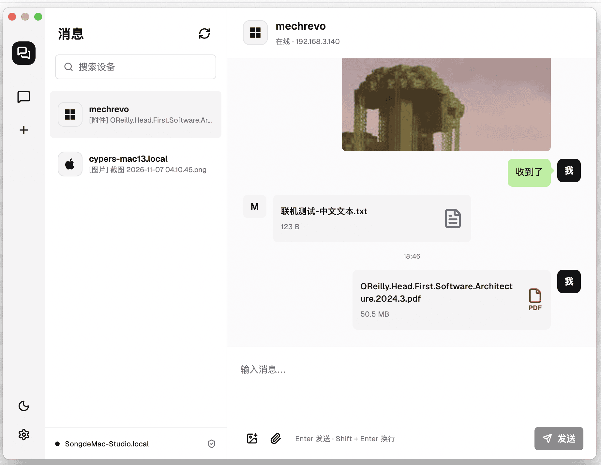

# EggplantChat

局域网文件传输工具，基于 Flutter 开发。



## Windows 安装与更新

双击生成的 `EggplantChat-<版本>-<提交号>-windows-x64-setup.exe`，按向导完成安装。支持 Windows 10/11 x64，包含 Visual C++ 运行库，无需单独安装 Flutter 或申请管理员权限。

默认安装目录为 `%LOCALAPPDATA%\Programs\EggplantChat`。安装后可从开始菜单启动，也可在安装时选择创建桌面快捷方式。

更新时先退出应用，再运行新版安装包并使用原安装目录。聊天记录和接收文件保存在独立的本地数据目录，更新或卸载应用会保留这些数据。可在应用设置中查看数据目录，通过 Windows 的“已安装的应用”卸载 EggplantChat。

## 运行

需要 Flutter 3.47.5 或兼容版本，以及对应平台的桌面编译环境。

```bash
flutter pub get
flutter run --profile -d macos
```

Windows 将 `macos` 换为 `windows`。

## 使用

在同一局域网的设备上启动应用，选择附近设备即可传输。未发现设备时，可刷新列表或通过 IP 连接，默认端口为 `53318`。

单个文件最大 10 GB，文件夹需先压缩。接收文件保存在本地数据目录，可在应用设置中查看。

需允许本地网络访问和防火墙通信：TCP `53318` 用于传输，UDP `53319` 用于设备发现。

仅在可信局域网使用；本地聊天记录未额外加密。

## 开发

```bash
flutter analyze
flutter test
flutter build macos --release
```

Windows 构建使用 `flutter build windows --release`。

### Windows 安装包

准备上述 Flutter 环境，安装 [Inno Setup 6 或 7](https://jrsoftware.org/inno-setup/downloads) 以及 Visual Studio 的 C++ 桌面开发组件，在仓库根目录运行：

```powershell
.\windows\installer\build.ps1
```

可通过 `-IsccPath` 指定 `ISCC.exe`，通过 `-RuntimeDir` 指定 Visual C++ 的 `Microsoft.VC143.CRT` x64 目录。已完成发布构建时可加 `-SkipBuild`。

安装包及 SHA-256 校验文件输出到 `build/installer/`。安装包支持 Windows 10 及以上 x64 系统，包含 Visual C++ 运行库，默认安装到当前用户目录，并提供开始菜单快捷方式、可选桌面快捷方式及卸载入口。卸载保留本地聊天数据。发行前可按需为安装包签名。

产物命名为 `EggplantChat-<版本>-<提交号>-windows-x64-setup.exe`，版本来自 `pubspec.yaml`，提交号来自当前 Git 提交。安装包、暂存文件和打包工具均保存在忽略的 `build/` 目录，不提交到源码仓库。

校验安装包时运行 `Get-FileHash <安装包路径> -Algorithm SHA256`，将结果与同名 `.exe.sha256` 文件中的值比较。

界面约定见 [docs/design.md](docs/design.md)。
